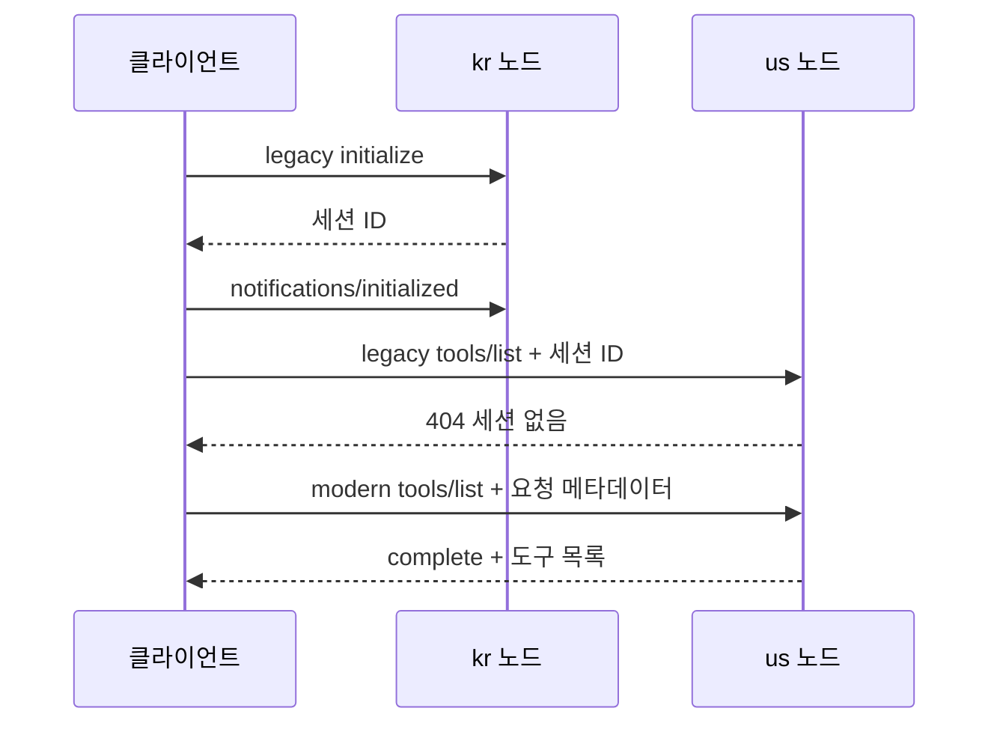

# MCP 명세 비교 예제

한 애플리케이션에서 **2025-11-25**와 **2026-07-28**의 초기화, 라우팅, 추가 입력 방식을 비교합니다. 두 버전 모두 같은 `search_documents` 도구로 예제용 문서를 검색합니다. 두 버전을 별도 프로젝트로 실행할 필요가 없으며, 외부 API 키나 LLM, DB도 필요하지 않습니다.

## 실행

Java 21.0.2, Gradle 8.14.5, Spring Boot 3.5.16을 사용합니다. 웹 스크립트 검증에 사용하는 Node.js도 mise에서 24.19.0으로 지정했습니다. 데모 클라이언트는 Python 3.9 이상에서 실행하며 표준 라이브러리만 사용합니다.

```bash
cd mcp-spec-comparison-example
mise trust
mise install
mise run test
mise run run
```

서버가 시작되면 브라우저에서 **http://127.0.0.1:8097/** 을 엽니다.

- 검색과 라우팅: 같은 입력으로 실제 요청을 보내고 단계별 헤더·본문·응답을 비교합니다.
- 추가 입력 처리: 클라이언트가 선택한 검색 범위를 서버에 보내거나 입력 요청을 거절합니다. 이전 방식의 SSE와 최신 방식의 MRTR을 비교합니다.
- 노드 변경: 요청을 다른 노드로 보내면 이전 방식은 세션을 찾지 못하고, 최신 방식은 도구 목록을 반환하는지 확인합니다.
- 헤더·본문 불일치: 최신 방식에서 헤더와 본문의 리전을 다르게 보내 HeaderMismatch 오류를 확인합니다.

화면은 외부 라이브러리 없이 HTML/CSS/JavaScript로 만들었습니다. 요청을 처리하는 동안에는 입력을 비활성화하고, 응답을 12초 이상 기다리면 요청을 중단합니다. 화면에 표시되는 시간만으로 두 버전의 성능을 비교할 수는 없습니다.

콘솔 데모는 다른 터미널에서 실행합니다.

```bash
cd mcp-spec-comparison-example
mise run demo
```

서버는 기본적으로 `127.0.0.1:8097`에서 실행됩니다. 다른 포트를 사용하려면 서버의 `SERVER_PORT`와 클라이언트 URL을 함께 바꿉니다.

```bash
SERVER_PORT=8098 mise run run
python3 scripts/demo.py --base-url http://127.0.0.1:8098
```

`demo.py`는 실제 HTTP 요청과 SSE 메시지를 출력하고 결과를 검증합니다. 실패하면 0이 아닌 종료 코드를 반환합니다. 모든 시나리오가 통과하면 마지막에 `PASS: all five real HTTP/SSE comparison scenarios`가 출력됩니다.

## 비교 항목

| 관찰 대상 | legacy: 2025-11-25 | modern: 2026-07-28 |
| --- | --- | --- |
| 호출 시작 | initialize → initialized → 일반 요청 | 각 요청에 버전·기능 메타데이터 |
| 세션 | 노드별 세션 ID 발급 | 세션 발급·조회 없음 |
| 라우팅 | 본문의 region을 파싱 | Mcp-Param-Region으로 선택 후 본문 대조 |
| 추가 입력 | SSE로 elicitation/create 발신, 별도 POST로 답 수신 | input_required 응답, inputResponses를 담아 새 요청 |
| 결과 | 기존 result | resultType: complete 또는 input_required |
| 목록 | 도구 정의 | x-mcp-header, ttlMs, cacheScope 포함 |

## 1. 초기화와 노드 상태

`/legacy/kr/mcp`에서 발급한 세션으로 `/legacy/us/mcp`를 호출하면 `404`입니다. 세션을 발급한 노드와 다음 요청을 받은 노드가 다르면 상태를 찾지 못하는 상황을 재현합니다. 이전 명세가 세션 ID 발급을 강제하는 것은 아닙니다. 이 예제에서는 다른 노드로 요청을 보냈을 때의 차이를 확인하기 위해 세션을 발급합니다.

최신 방식은 `/modern/kr/mcp`와 `/modern/us/mcp` 어디든 초기화 없이 호출합니다. 각 요청의 `_meta`에 버전과 클라이언트가 지원하는 기능을 넣습니다.



## 2. 본문 라우팅과 헤더 라우팅

`/legacy/mcp`와 `/modern/mcp`로 요청을 보내면 서버가 리전에 따라 노드를 선택합니다. 응답의 `X-Demo-Routing`은 본문(`body`)과 헤더(`headers`) 중 무엇으로 노드를 골랐는지 나타냅니다. `X-Demo-Node`에서는 선택된 노드(`kr` 또는 `us`)를 확인할 수 있습니다. 이 응답 헤더는 학습용이며 MCP 표준이 아닙니다.

최신 방식에서는 JSON 파싱 전에 `Mcp-Param-Region`을 읽습니다. 서버는 이후 `MCP-Protocol-Version`, `Mcp-Method`, `Mcp-Name`, 지정된 리전 헤더를 본문과 대조합니다. 리전 헤더에 `kr`, 본문 인자에 `us`를 보내면 `400 / -32020 HeaderMismatch`로 거부합니다.

```text
POST /modern/mcp
  Mcp-Method: tools/call
  Mcp-Name: search_documents
  Mcp-Param-Region: kr
        ↓ 헤더로 노드 선택
  kr 노드
        ↓ 헤더와 본문 검증
  공통 DocumentSearch 실행
```

이 예제는 **하나의 JVM 안에서 게이트웨이와 두 노드의 역할을 나눠 처리합니다.** 실제 프록시가 별도 서버로 요청을 전달하거나 장애에서 복구하는 과정은 다루지 않습니다. 노드를 직접 지정하는 URL은 다른 노드에서 세션을 찾지 못하는 상황을 재현할 때 사용합니다. 목록·초기화처럼 리전이 없는 요청은 `kr`로 보냅니다. `us` 노드를 사용하려면 `/legacy/us/mcp`에서 초기화하고, 후속 요청과 추가 입력 응답도 같은 경로로 보내야 합니다.

## 3. 서버 발신 요청과 MRTR

`scope` 인자가 없으면 `public` 또는 `team`을 묻습니다. 두 값은 예제 문서의 검색 범위를 구분하며, 접근 권한을 나타내지는 않습니다.

- 이전 방식: 서버가 첫 `tools/call`의 SSE 응답 스트림으로 `elicitation/create` 요청을 보냅니다. 클라이언트가 그 요청 ID에 대한 JSON-RPC 응답을 POST하면, 기존 SSE 스트림에 원래 도구 호출 결과가 전달됩니다.
- 최신 방식: `inputRequests.scope`를 포함한 `input_required`로 첫 요청을 마칩니다. 클라이언트는 새 JSON-RPC ID와 `params.inputResponses.scope`를 담아 원래 도구 호출을 다시 보냅니다.

최신 예제는 조회 인자가 재요청에 모두 포함되므로 `requestState`를 생성하거나 저장하지 않습니다. 클라이언트는 서버가 `requestState`를 반환하면 재요청에 그 값을 그대로 넣습니다. 여기에 실제 상태를 담도록 확장한다면, 서버는 값이 변조되거나 만료되지 않았는지, 같은 사용자의 원래 요청에 해당하는지 확인해야 합니다.

## 코드 위치

- `ComparisonController`: HTTP 진입점, 헤더/본문 라우팅, 오류 응답
- `McpSpecComparisonExampleApplication`: Spring Boot 실행 클래스
- `presentation`: HTTP 엔드포인트와 JSON-RPC 요청 형식 검증
- `protocol`: 공통 JSON-RPC 응답과 오류
- `protocol.legacy`: 초기화·세션 처리(`LegacyProtocol`), 세션 상태(`LegacySession`), SSE 입력 요청·응답(`LegacyElicitation`, `PendingElicitation`)
- `protocol.modern`: 요청별 처리와 MRTR(`ModernProtocol`), 헤더 대조(`ModernHeaderValidator`)
- `tool`: 두 버전이 공유하는 도구 정의와 문서 검색(`DocumentSearch`)
- `src/main/resources/application.yml`: 애플리케이션 이름과 로컬 서버 주소·포트
- `ComparisonTest`: 임의 포트로 실행한 Spring Boot 서버에 HTTP/SSE 요청을 보내는 통합 테스트
- `scripts/demo.py`: 단계별 요청·응답을 출력하는 실행 클라이언트
- `postman/comparison.postman_collection.json`: 기본 요청과 오류 응답을 확인하는 Postman 컬렉션

## 검증

```bash
mise run ci
```

초기화 전 호출, initialized 누락, 다른 노드의 세션 사용, 초기화 없는 최신 호출, 동일 검색 결과, 헤더 불일치, capability 누락, 버전 불일치, MRTR 수락·거절, SSE 왕복, 잘못된 JSON을 검사합니다. `build/reports/tests/test/index.html`에서 결과를 볼 수 있습니다.

Postman CLI가 설치되어 있다면 로컬 컬렉션도 실행할 수 있습니다. 로그인이나 클라우드 게시가 필요하지 않습니다. 이전 방식의 SSE 요청과 추가 입력 응답은 Python 데모와 Java 통합 테스트에서 검증합니다.

```bash
postman collection run postman/comparison.postman_collection.json --no-report-events
```

### CI의 웹 검증

`mise run ci`는 mise 설정 검사, Gradle 빌드·서버 통합 테스트, JavaScript 구문 검사, 웹 스크립트 HTTP 회귀 테스트를 순서대로 실행합니다.

```bash
mise run web:check
mise run web:test
```

웹 회귀 테스트는 Node.js 내장 테스트 도구로 실제 `comparison.js`를 실행합니다. 임의 포트에 Spring Boot 서버를 띄워 한국·미국 검색, SSE/MRTR 입력 수락·거절, 노드 변경, 헤더 불일치를 검증합니다. 네트워크 요청이 실패했을 때 오류를 표시하고 입력을 다시 활성화하는지, 검색어가 비어 있으면 요청을 보내지 않는지도 확인합니다. 테스트가 끝나면 테스트용 서버를 종료합니다. 별도 포트를 사용하므로 8097 포트에서 실행 중인 서버와 충돌하지 않습니다.

실제 브라우저 대신 테스트에 필요한 DOM 동작만 구현한 어댑터를 사용합니다. 따라서 화면 배치, 접근성, 이벤트 전파까지 확인하는 브라우저 E2E 테스트는 아닙니다. 화면 크기에 따른 배치와 실제 조작은 브라우저에서 별도로 확인해야 합니다. 외부 테스트 라이브러리는 추가하지 않았습니다.

`bin/`, `build/`, `.gradle/` 등 생성물은 Git에서 제외합니다. `.gitattributes`는 기존 예제처럼 `gradlew`의 LF, 배치 파일의 CRLF, JAR의 바이너리 처리를 지정합니다.

## 지원 범위와 한계

두 버전의 차이를 학습할 수 있도록 명세의 일부 기능만 구현했습니다. 범용 MCP 서버나 SDK로 사용할 수는 없습니다. 기존 Spring Web/Jackson으로 요청과 응답을 직접 처리하며, MCP SDK 의존성은 추가하지 않았습니다. 코드에서 두 버전의 메시지 형식을 비교할 수 있도록 했습니다.

- 지원: 단일 JSON-RPC 요청, initialize/initialized, tools/list, search_documents, form elicitation, 최신 server/discover와 기본 MRTR.
- 미지원: OAuth·인증, stdio, resources/prompts, subscriptions, Tasks, progress/cancellation, SSE 재개, 자동 버전 fallback, 임의 도구 스키마·헤더를 처리하는 범용 클라이언트.
- 로컬 전용: loopback에 바인딩하고 브라우저 Origin은 실행 중인 서버와 같은 포트의 localhost/127.0.0.1만 허용합니다. 다른 Origin과 다른 포트는 거부하며 CORS는 열지 않습니다. 운영 인증·권한 처리를 제공하지 않습니다.
- 이전 방식의 세션은 최대 1,000개까지 저장하며, 생성 후 5분 동안 유지합니다. 새 초기화 요청을 받으면 만료된 세션을 정리합니다. 세션마다 한 번에 하나의 추가 입력만 기다릴 수 있으며, 15초가 지나면 스트림을 종료합니다. 세션을 다시 발급받거나 요청을 재시도하는 처리는 클라이언트에서 해야 합니다.
- 최신 방식의 리전 라우팅은 ASCII 문자열인 `kr`과 `us`만 지원합니다. 모든 `x-mcp-header` 스키마와 인코딩 규칙을 구현한 것은 아닙니다.
- 두 버전의 성능 차이는 측정하지 않았습니다. 최신 방식에서도 클라이언트는 요청마다 메타데이터를 보내고, 서버는 헤더와 본문의 값이 일치하는지 확인해야 합니다.

## 참고

- [2026-07-28 변경 내역](https://modelcontextprotocol.io/specification/2026-07-28/changelog)
- [Streamable HTTP](https://modelcontextprotocol.io/specification/2026-07-28/basic/transports/streamable-http)
- [MRTR](https://modelcontextprotocol.io/specification/2026-07-28/basic/patterns/mrtr)
