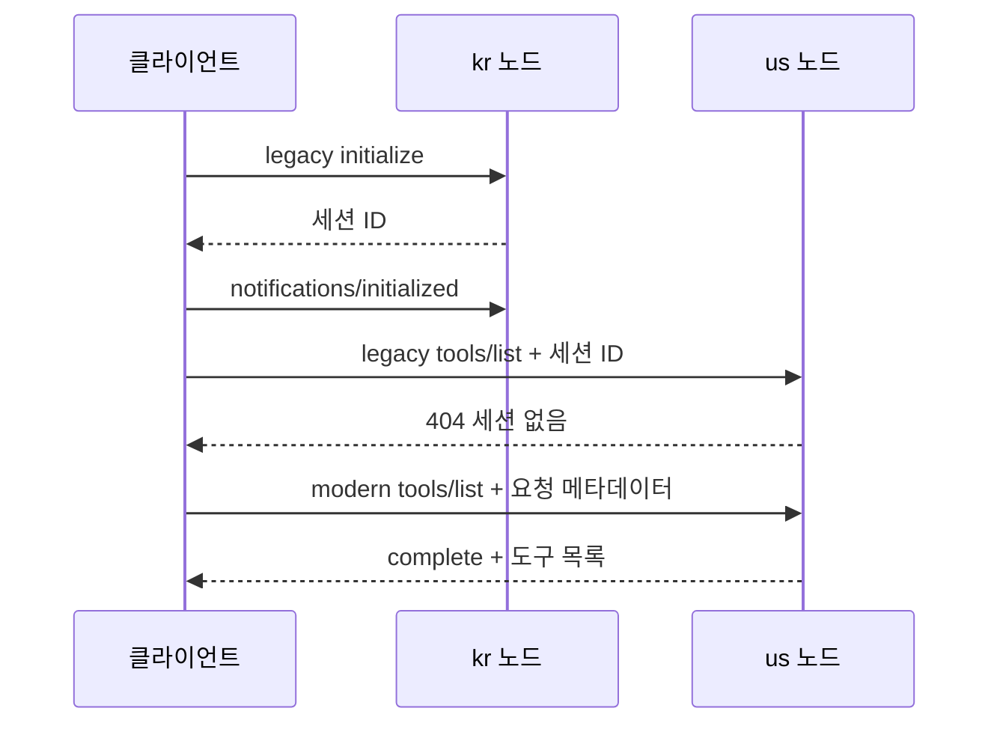

# MCP 명세 비교 예제

한 애플리케이션에서 **2025-11-25**와 **2026-07-28**의 초기화, 라우팅, 추가 입력 방식을 비교합니다. 두 버전 모두 `search_documents`와 같은 합성 문서 데이터를 사용합니다. 별도 저장소나 외부 API 키, LLM, DB가 필요하지 않습니다.

## 실행

Java 21.0.2, Gradle 8.14.5, Spring Boot 3.5.16을 사용합니다. 웹 스크립트 검증용 Node.js 24.19.0도 mise로 고정합니다. 데모 클라이언트는 Python 3.9 이상 표준 라이브러리만 사용합니다.

```bash
cd mcp-spec-comparison-example
mise trust
mise install
mise run test
mise run run
```

웹 비교 화면은 서버 실행 후 **http://127.0.0.1:8097/** 에서 엽니다.

- 검색과 라우팅: 같은 입력으로 실제 요청을 보내고 단계별 헤더·본문·응답을 비교합니다.
- 추가 입력 처리: 선택한 검색 범위로 자동 응답하거나 거절합니다. legacy SSE와 modern MRTR을 비교합니다.
- 노드 변경: 다른 노드의 legacy 세션 조회 실패와 modern 목록 조회 성공을 확인합니다.
- 헤더·본문 불일치: modern의 HeaderMismatch 오류를 재현합니다.

화면은 외부 라이브러리 없이 정적 HTML/CSS/JavaScript로 구성합니다. 요청이 진행되는 동안 입력을 잠그고 12초 제한을 적용합니다. 표시 시간은 성능 비교용이 아닙니다.

콘솔 데모는 다른 터미널에서 실행합니다.

```bash
cd mcp-spec-comparison-example
mise run demo
```

서버는 기본적으로 `127.0.0.1:8097`에서 실행됩니다. 다른 포트를 사용하려면 서버의 `SERVER_PORT`와 클라이언트 URL을 함께 바꿉니다.

```bash
SERVER_PORT=8098 mise run run
python3 scripts/demo.py --base-url http://127.0.0.1:8098
```

`demo.py`는 실제 HTTP 요청과 SSE 메시지를 출력하고 결과를 검증합니다. 실패하면 0이 아닌 종료 코드를 반환합니다. `PASS: all five real HTTP/SSE comparison scenarios`가 마지막에 출력되어야 합니다.

## 비교 항목

| 관찰 대상 | legacy: 2025-11-25 | modern: 2026-07-28 |
| --- | --- | --- |
| 호출 시작 | initialize → initialized → 일반 요청 | 각 요청에 버전·기능 메타데이터 |
| 세션 | 노드별 세션 ID 발급 | 세션 발급·조회 없음 |
| 라우팅 | 본문의 region을 파싱 | Mcp-Param-Region으로 선택 후 본문 대조 |
| 추가 입력 | SSE로 elicitation/create 발신, 별도 POST로 답 수신 | input_required 응답, inputResponses를 담아 새 요청 |
| 결과 | 기존 result | resultType: complete 또는 input_required |
| 목록 | 도구 정의 | x-mcp-header, ttlMs, cacheScope 포함 |

## 1. 초기화와 노드 상태

`/legacy/kr/mcp`에서 발급한 세션으로 `/legacy/us/mcp`를 호출하면 `404`입니다. 세션을 발급한 노드와 다음 요청을 받은 노드가 다르면 상태를 찾지 못하는 상황을 재현합니다. 이전 명세가 세션 ID 발급을 강제하는 것은 아닙니다. 이 예제는 차이를 관찰하기 위해 선택적으로 세션을 발급합니다.

최신 방식은 `/modern/kr/mcp`와 `/modern/us/mcp` 어디든 초기화 없이 호출합니다. 각 요청에 `_meta`의 버전과 클라이언트 기능을 넣습니다.



## 2. 본문 라우팅과 헤더 라우팅

`/legacy/mcp`, `/modern/mcp`는 라우팅 비교 진입점입니다. `X-Demo-Routing: body` 또는 `headers`, `X-Demo-Node: kr` 또는 `us`로 선택 결과를 확인합니다. 이 응답 헤더는 학습용이며 MCP 표준이 아닙니다.

최신 방식에서는 JSON 파싱 전에 `Mcp-Param-Region`을 읽습니다. 서버는 이후 `MCP-Protocol-Version`, `Mcp-Method`, `Mcp-Name`, 지정된 리전 헤더를 본문과 대조합니다. `kr` 헤더와 `us` 인자를 보내면 `400 / -32020 HeaderMismatch`로 거부합니다.

```text
POST /modern/mcp
  Mcp-Method: tools/call
  Mcp-Name: search_documents
  Mcp-Param-Region: kr
        ↓ 헤더로 노드 선택
  kr 노드
        ↓ 헤더와 본문 검증
  공통 DocumentSearch 실행
```

이 예제의 게이트웨이와 두 노드는 **하나의 JVM 안에서 호출하는 논리 구성**입니다. 외부 프록시나 두 프로세스로의 네트워크 전달, 장애 복구를 검증한 예제가 아닙니다. 노드를 직접 고르는 URL은 세션 이동 실패를 재현하기 위한 학습용입니다. 목록·초기화처럼 리전이 없는 요청은 `kr`로 보냅니다. `us` 세션은 `/legacy/us/mcp`에서 초기화하고 같은 경로에 응답해야 합니다.

## 3. 서버 발신 요청과 MRTR

`scope` 인자가 없으면 `public` 또는 `team`을 묻습니다. 둘 모두 합성 데이터의 검색 분류이며 권한을 뜻하지 않습니다.

- 이전 방식: 첫 `tools/call`의 SSE 응답에 서버가 `elicitation/create` 요청을 씁니다. 클라이언트가 그 요청 ID에 대한 JSON-RPC 응답을 POST하면, 기존 SSE 스트림에 원래 도구 호출 결과가 전달됩니다.
- 최신 방식: `inputRequests.scope`를 포함한 `input_required`로 첫 요청을 마칩니다. 클라이언트는 새 JSON-RPC ID와 `params.inputResponses.scope`를 담아 원래 도구 호출을 다시 보냅니다.

최신 예제는 조회 인자가 재요청에 모두 포함되므로 `requestState`를 생성하거나 저장하지 않습니다. 클라이언트에는 서버가 해당 필드를 반환한 경우 그대로 돌려주는 처리도 있습니다. 실제 상태를 담는 예제로 확장한다면 무결성·사용자·만료·원래 요청과의 연결을 검증해야 합니다.

## 코드 위치

- `ComparisonController`: HTTP 진입점, 헤더/본문 라우팅, 오류 응답
- `LegacyProtocol`: 노드에 연결된 초기화 상태, SSE 서버 요청과 클라이언트 응답 연결
- `ModernProtocol`: 요청별 메타데이터, 헤더 검증, MRTR, server/discover
- `DocumentSearch`: 두 버전이 공유하는 도구 정의와 검색
- `ComparisonTest`: 임의 포트의 실제 Spring Boot 서버에 HTTP/SSE 요청하는 통합 테스트
- `scripts/demo.py`: 단계별 요청·응답을 출력하는 실행 클라이언트
- `postman/comparison.postman_collection.json`: 가져와 실행할 수 있는 기본 요청과 오류 검증

## 검증

```bash
mise run ci
```

초기화 전 호출, initialized 누락, 다른 노드의 세션 사용, 초기화 없는 최신 호출, 동일 검색 결과, 헤더 불일치, capability 누락, 버전 불일치, MRTR 수락·거절, SSE 왕복, 잘못된 JSON을 검사합니다. `build/reports/tests/test/index.html`에서 결과를 볼 수 있습니다.

Postman CLI가 설치되어 있다면 로컬 컬렉션도 실행할 수 있습니다. 로그인이나 클라우드 게시가 필요하지 않습니다. legacy SSE 왕복은 Python 데모와 Java 통합 테스트에서 검증합니다.

```bash
postman collection run postman/comparison.postman_collection.json --no-report-events
```

### CI의 웹 검증

`mise run ci`는 mise 설정 검사, Gradle 빌드·서버 통합 테스트, JavaScript 구문 검사, 웹 스크립트 HTTP 회귀 테스트를 순서대로 실행합니다.

```bash
mise run web:check
mise run web:test
```

웹 회귀 테스트는 Node.js 내장 테스트 도구로 실제 `comparison.js`를 실행합니다. 임의 포트에 Spring Boot 서버를 띄워 한국·미국 검색, SSE/MRTR 입력 수락·거절, 노드 변경, 헤더 불일치를 검증합니다. 네트워크 실패 시 오류 표시·입력 복구와 빈 검색어 차단도 확인합니다. 테스트 서버는 종료 시 정리하며 기존 8097 서버와 충돌하지 않습니다.

DOM은 최소 어댑터로 제공하므로 실제 브라우저의 레이아웃·접근성·이벤트 전파를 검증하는 E2E 테스트는 아닙니다. 화면 배치와 반응형 표시는 브라우저에서 별도로 확인합니다. 외부 테스트 라이브러리는 추가하지 않았습니다.

`bin/`, `build/`, `.gradle/` 등 생성물은 Git에서 제외합니다. `.gitattributes`는 기존 예제처럼 `gradlew`의 LF, 배치 파일의 CRLF, JAR의 바이너리 처리를 지정합니다.

## 지원 범위와 한계

교육용 프로토콜 부분 구현이며 범용 MCP 서버·SDK 또는 전체 명세 준수 구현이 아닙니다. 저장소의 Spring Web/Jackson을 재사용하고 새 SDK 의존성은 추가하지 않았습니다. 두 버전의 wire 형식이 드러나도록 직접 작성했습니다.

- 지원: 단일 JSON-RPC 요청, initialize/initialized, tools/list, search_documents, form elicitation, 최신 server/discover와 기본 MRTR.
- 미지원: OAuth·인증, stdio, resources/prompts, subscriptions, Tasks, progress/cancellation, SSE 재개, 자동 버전 fallback, 임의 도구 스키마·헤더를 처리하는 범용 클라이언트.
- 로컬 전용: loopback에 바인딩하고 브라우저 Origin은 실행 중인 서버와 같은 포트의 localhost/127.0.0.1만 허용합니다. 다른 Origin과 다른 포트는 거부하며 CORS는 열지 않습니다. 운영 인증·권한 처리를 제공하지 않습니다.
- legacy 세션은 최대 1,000개, 생성 후 5분 유지합니다. 정리는 새 초기화 때 수행합니다. 대기 중 입력은 세션당 하나이며 15초 후 스트림을 종료합니다. 세션 재발급·재시도는 호출자가 처리합니다.
- 최신 리전 라우팅은 `kr`/`us` ASCII 값만 지원합니다. 임의 `x-mcp-header` 스키마와 인코딩 전체를 지원한다고 주장하지 않습니다.
- 성능 개선 수치는 측정하지 않았습니다. 메타데이터 반복 전송과 본문 검증 비용은 남습니다.

## 참고

- [2026-07-28 변경 내역](https://modelcontextprotocol.io/specification/2026-07-28/changelog)
- [Streamable HTTP](https://modelcontextprotocol.io/specification/2026-07-28/basic/transports/streamable-http)
- [MRTR](https://modelcontextprotocol.io/specification/2026-07-28/basic/patterns/mrtr)
